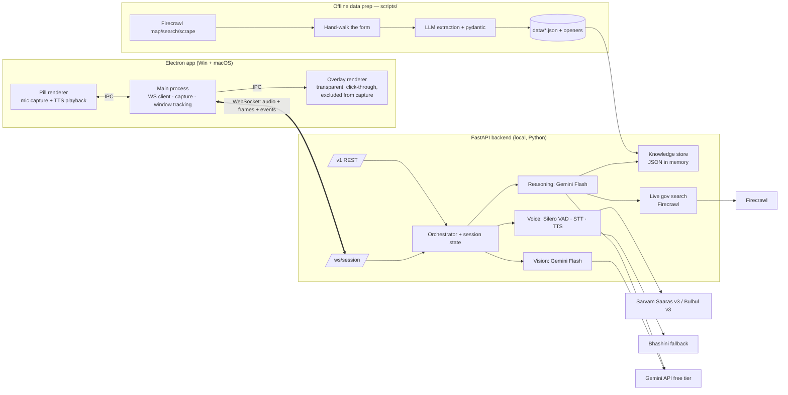

# Suraksha — MVP Playbook (scratch → demo-ready)

**This is the single source of truth.** Everything needed to build the hackathon MVP is here: product, flow, architecture, data collection, setup, build steps per track, prompts, code skeletons, testing, and demo prep. If something isn't in this doc, decide it in team chat and add it here before coding.

**Time box:** 27 hours · **Team:** 2 people — **P1 (Desktop + Data)** and **P2 (Backend + Voice)**, see §0A · **AI coding agents allowed** — point every agent at this file first.

> Tracks A, B, C in §10–§12 are *work areas*, not people. §0A says who owns which, and overrides any per-track ownership elsewhere in this doc.

---

## Table of contents
0. Hour-0 checklist (do this first)
0A. Team of two — split & collaboration
1. Product definition
2. User flow
3. Architecture
4. Tech stack & accounts
5. Repo setup
6. Data collection (knowledge)
7. Data contracts (schemas)
8. Interfaces (WebSocket, REST, vision, voice, reasoning)
9. Session state machine
10. Track A — Desktop build steps
11. Track B — Backend, vision, reasoning, knowledge build steps
12. Track C — Voice build steps
13. Prompts
14. Development stages (0–8) with exit checks
15. Testing
16. Privacy & safety rules
17. Known gotchas & fixes
18. Fallbacks
19. Demo prep & script
20. Definition of done

---

## 0. Hour-0 checklist (whole team, first 60 minutes)

- [ ] **Pick the demo form** (criteria §6.1). Write `process_id`, portal URL, state → `DECISIONS.md`
- [ ] **Pick demo languages:** 1 primary (e.g. Hindi) + 1–2 regional languages from Bulbul v3's list (§4.3) so voice quality is high
- [ ] **Confirm hardware:** one Windows laptop + one Mac available all 27 h; one headset mic for the demo
- [ ] **Create accounts / keys** (§4.2): Gemini (AI Studio) ×2 projects, Sarvam, Bhashini, Firecrawl
- [ ] **Check Gemini free-tier limits** for your chosen Flash model in AI Studio's rate-limit page → write RPM/RPD in `DECISIONS.md` (design budget in §8.3 depends on it)
- [ ] **Create the repo** (§5), commit this playbook as `PLAYBOOK.md`
- [ ] **Commit schemas** (§7) to `shared/schemas/` before any feature code
- [ ] Each person starts their agents with: *"Read PLAYBOOK.md fully. You are working for P1/P2 on <area>. Follow §0A, the build steps in §10/11/12 and the contracts in §7–§9 exactly. Only edit files in <owned folders>."*

---

## 0A. Team of two — split & collaboration

### Who owns what
Split by **runtime and folder**, so the two of you never edit the same files.

| | **P1 — Desktop + Data** | **P2 — Backend + Voice** |
|---|---|---|
| Work areas | Track A (§10) · Data collection (§6) · demo assets & video | Track B minus data (§11) · Track C (§12) |
| Language | TypeScript (Electron) + light Python scripts | Python |
| Owns folders | `desktop/` · `data/` · `demo/` · `scripts/` (data scripts) · `run/` | `backend/` · `scripts/eval_*.py` |
| Shared (change only together) | `shared/schemas/` · `PLAYBOOK.md` · `DECISIONS.md` | same |
| Machines | Owns cross-OS testing: runs every exit check on **both** laptops | Main dev on own laptop; joins every exit check |
| Agents in parallel | Agent 1: desktop · Agent 2: data scripts / form-map building | Agent 1: orchestrator + vision + reasoning · Agent 2: voice pipeline + providers |

**Why this split:** desktop and data both need both OS machines and lots of hands-on clicking (hand-walking the form, screenshots, permissions, coordinate checks). Backend and voice are both Python services that meet in the orchestrator, so one person keeps that logic consistent.

### Scope trims for two people
| Item | 3-person plan | 2-person plan |
|---|---|---|
| Demo languages | 2–3 | **2** (Hindi + one regional language from Bulbul's list) |
| Schemes KB | 20–40 | **15–20**, hand-picked for one target user (e.g. farmer) |
| Eval questions | ~30 | **~20** (10 form, 4 schemes, 3 code-mixed, 3 unanswerable) |
| Live gov search (Firecrawl at runtime) | Stage 4 | **Stretch** |
| Stuck check-ins, idle stop, multi-monitor | Stage 4 | Stage 5, cut first if behind |
| Stretch items | after gate | only if gate passed **before hour 11** |

### How you work in parallel without waiting on each other
Freeze the contracts in Stage 0, then each person builds against a **fake of the other side**:
- **P1 builds against `desktop/dev/mock_backend.ts`**: a tiny WebSocket server that replays scripted messages (`overlay.highlight`, `assistant.say` + a test WAV, `capture.control`, `link.card`). P1 never waits for real AI to test the overlay.
- **P2 builds against `backend/dev/fake_client.py`**: sends saved screenshots from `demo/screens/` as `frame` messages and WAV clips from `demo/test_audio/` as mic audio, and prints everything the server sends back. P2 never needs the Electron app running to test the brain.
- Both fakes speak exactly the §8.1 protocol. If a fake needs a new message, add it to §8.1 and `shared/schemas/` first, then tell the other person.

### Two-person stage plan (replaces the per-track rows in §14 when they conflict)
| Stage | Hours | P1 — Desktop + Data | P2 — Backend + Voice | Together |
|---|---|---|---|---|
| 0 Setup | 0–1 | Electron scaffold on both OS · Firecrawl key test · Bhashini registration | FastAPI scaffold + `/health` · schemas in `shared/schemas/` · Gemini + Sarvam test calls | Pick form + languages · agree contracts · repo + start scripts |
| 1 Foundations | 1–4 | Overlay + pill + browser tracking + hardcoded box (§A2–A4) · **hand-walk the form + screenshots on both OS** (§6.4 step 3) · source map + scrape (steps 1–2) | Vision detector on P1's first screenshots (§B2) · Sarvam STT/TTS streaming script (§C1) · `fake_client.py` | Hour 4: 10-min demo swap |
| 2 Vertical slice | 4–8 | Capture + crop + diff + coordinate mapping + WS client + mic/playback (§A5–A9) · `mock_backend.ts` · form map v1 (step 4) | WS server, session states `idle → watching → guiding_field`, orchestrator `on_frame`, budget · voice pipeline VAD → STT → TTS (§C3) | **Hour 8: Integration 1** — sit together, real app ↔ real backend |
| 3 Core loop | 8–12 | Highlight follows fields + scroll · captions · glossary + guidance review · openers generated (steps 6–8) · eval + voice test sets (step 9) | Full field loop, page change, intent → link card → consent, sourced answers, pre-generated guidance · barge-in + self-echo guard | **Hour 12: GATE** · swap-verify data (P2 checks P1's data) · tag `data-v1` |
| 4 Robustness | 12–16 | Secure pause · reconnect · macOS permission flow · schemes KB (step 5, trimmed) | Errors → fixes · `paused_secure` / `pre_submit_review` / `after_submit` · low-confidence paths · Bhashini fallback | P1 sleeps ~13–16 while P2 codes |
| 5 Breadth | 16–20 | UI polish · start scripts final · stretch if earned | Consultancy flow · REST endpoints · language switching · stuck/idle timers | P2 sleeps ~16–19 while P1 codes |
| 6 Hardening | 20–22 | Run all tests on both OS · privacy checks (§15.6) | Vision + grounding evals · budget soak · fix bugs | Bug bash: each runs the full flow on the other's laptop |
| 7 Demo prep | 22–25 | Backup video · demo laptop setup | Slides · `/health` checks · credits/keys | Script, roles, 3 timed rehearsals |
| 8 Freeze | 25–27 | Fixes only | Fixes only | Final rehearsal, rest |

**Hand-off rule during sleep shifts:** before sleeping, push to `main`, write 3 lines in `HANDOFF.md` (what works, what's broken, what's next), and make sure the start script runs.

### Collaboration rhythm
- **Every 2 hours, a 10-minute sync** (set alarms at H2, H4, H6…): each person shows their demo (not a status report), names any blocker, and you agree on any contract change.
- **Contract changes:** propose in chat → update `shared/schemas/` + §8.1 in one commit → the other person pulls before continuing. Never change a message format silently.
- **Git:** both push to `main` with small commits in your own folders. Because folders don't overlap, conflicts should only happen in `shared/` — so change it together. Pull before each sync.
- **Blocked on the other person for more than 15 minutes?** Extend your fake (`mock_backend.ts` / `fake_client.py`) and keep going; don't wait.
- **Decisions:** any choice that changes behaviour goes into `DECISIONS.md` (one line, with the hour). Agents read it too.
- **Integration is done together, side by side,** at hours 8 and 12. Don't integrate alone.

---

## 1. Product definition

**Suraksha** is a floating desktop assistant (Windows + macOS) for Indian citizens. With the user's permission it watches their browser, highlights the next form field, explains it out loud in the user's language, answers questions from official sources, and suggests relevant government schemes. **It never types, clicks, or submits for the user.**

**Target user:** a citizen filling a government form online who is unsure of terms, documents, or rules, and prefers speaking in their own language (code-mixed speech is normal).

**MVP scope (must ship)**
- Overlay on Windows and macOS
- Live watching after "guide me" — no hotkey per step
- Live two-way voice in Indian languages with barge-in (user can interrupt)
- Field highlighting on one real government form in the user's normal browser
- Grounded answers with sources; honest "not sure" + official link
- Consultancy: scheme suggestions from official sources
- REST API so a mobile client can reuse the backend

**Not in MVP:** auto-fill/submit, user accounts, database, stored screenshots/values, accessibility-tree integration (stretch), more than 1 form (stretch).

---

## 2. User flow

1. **First launch** — mic + screen permission (friendly pre-prompt), one-line privacy promise. No language picker; user just speaks.
2. **Idle** — small floating pill with mic button. Nothing captured.
3. **Need** — user: *"Mujhe income certificate banwana hai."* Suraksha asks only what's needed (state, for whom), one question at a time.
4. **Consultancy branch** — user: *"Kisaan hoon, koi yojana hai mere liye?"* → a few eligibility questions → 2–3 schemes with reasons + official sources → user picks one.
5. **Link card** — process name, department, official URL, "verified on." User clicks **Open link** → their normal browser.
6. **Consent** — *"Should I watch your screen and guide you?"* → yes → "Suraksha is watching" indicator. From now: open mic, no hotkey.
7. **Page recognition** — on screen change, identify the page/step. Login/OTP/password → guide by voice, pause capture during sensitive input.
8. **Field loop** — highlight field → instant opener audio → live explanation (official terms kept) → ask-backs if needed (*"for yourself or a family member?"*) → stay quiet while typing → detect filled → next field. Off-screen → *"scroll down a little."*
9. **Interrupts anytime** — user speaks → Suraksha stops talking → answers with source → *"Shall we continue?"*
10. **Stuck** (~20 s no progress) → gentle check-in. **Errors** (red text) → explain fix. **Uploads** → which document, format, size.
11. **Pre-submit** — spoken review checklist → *"When you're ready, you press Submit."*
12. **After submit** — what happens next (reference number to note, tracking, timeline). Session ends → all frames and context wiped.

---

## 3. Architecture



**Key decisions (do not re-open)**
| Decision | Why |
|---|---|
| Voice pipeline in Python backend | Sarvam, Bhashini, Silero VAD SDKs are Python; one place for barge-in |
| One WebSocket per session for audio + frames + events | Simple ordering, one thing to debug |
| Capture display → crop to browser window bounds on device | Simple coordinates; only browser pixels leave the laptop |
| Overlay excluded from screen capture (`setContentProtection(true)`) | Our own highlights must not trigger frame diffs or confuse vision |
| Vision bbox = Gemini native `[ymin,xmin,ymax,xmax]` 0–1000, relative to the crop | No custom coordinate parsing |
| Knowledge = JSON in git, loaded in memory | No DB; versioned; fast |
| Base guidance text pre-generated offline per field × language | Saves Gemini calls (free-tier RPM) and latency |
| Sarvam primary voice, Bhashini fallback, Gemini text/vision only | Best Indian-language voice quality + coverage; voice stays in India |

---

## 4. Tech stack & accounts

### 4.1 Stack
| Layer | Choice |
|---|---|
| Desktop | Electron (latest stable) + TypeScript, `ws`, `get-windows` |
| Backend | Python 3.11+, FastAPI, uvicorn, pydantic v2, numpy |
| Vision + reasoning | Gemini Flash / Flash-Lite via `google-genai` SDK (free tier) |
| STT | Sarvam **Saaras v3** streaming (WebSocket), mode `codemix` |
| TTS | Sarvam **Bulbul v3** streaming; **Bhashini** for languages Bulbul lacks |
| VAD | Silero VAD (`silero-vad` pip) |
| Data prep | Firecrawl (`firecrawl-py`), Sarvam Document Digitization for scanned PDFs |
| Fallback voice | Bhashini (`bhashini-client-sdk`) |

### 4.2 Accounts & keys (hour 0)
| Service | Where | Notes |
|---|---|---|
| Gemini | aistudio.google.com → API key | Make **2 projects** (primary + backup — quota is per project). Free tier: inputs may be used to improve Google products → dummy data only |
| Sarvam | dashboard.sarvam.ai | Free signup credits; STT ≈ ₹30/hour audio. Check balance before judging |
| Bhashini | bhashini.gov.in | **Register in hour 0** — approval/credential setup may not be instant |
| Firecrawl | your existing account | Tokens for data prep + live gov search |

### 4.3 Language coverage
- **Sarvam Bulbul v3 TTS:** Hindi, Bengali, Tamil, Telugu, Gujarati, Kannada, Malayalam, Marathi, Punjabi, Odia, English (Indian accent)
- **Sarvam Saaras v3 STT:** 22 Indian languages, auto language detection, code-mixing
- **Bhashini:** 22 scheduled languages (TTS for anything outside Bulbul's list)
- Pick demo languages from Bulbul's list for best quality; mention 22-language coverage via Bhashini in the pitch.

### 4.4 SDK docs (give these to agents)
- Sarvam: `https://docs.sarvam.ai/llms-full.txt` (full docs in one file; also an MCP server at `https://docs.sarvam.ai/_mcp/server`)
- Gemini: `https://ai.google.dev/gemini-api/docs` (structured output, image understanding, bounding boxes)
- Firecrawl: official docs for `map`, `search`, `scrape`
- Bhashini: `pip install bhashini-client-sdk` (README on PyPI)

> SDK method names change between versions. Code skeletons below show intent; **agents must verify exact signatures against the docs above.**

---

## 5. Repo setup

```
suraksha/
├─ PLAYBOOK.md              # this file
├─ README.md                # chosen form, how to run, owners
├─ DECISIONS.md             # one line per settled decision
├─ HANDOFF.md               # 3-line note before each sleep shift
│  (desktop/dev/mock_backend.ts and backend/dev/fake_client.py: fakes for parallel work, §0A)
├─ .env.example
├─ shared/schemas/          # pydantic models (source) + generated TS types
├─ desktop/                 # Track A
│  ├─ src/main/             # index.ts, overlay.ts, pill.ts, capture.ts, windows.ts, session.ts, permissions.ts
│  ├─ src/renderer/pill/    # mic (AudioWorklet), playback, UI
│  ├─ src/renderer/overlay/ # highlight drawing
│  └─ package.json
├─ backend/                 # Track B (+ C in voice/)
│  ├─ app.py                # FastAPI entry
│  ├─ api/ws_session.py  api/rest.py
│  ├─ core/session.py  core/orchestrator.py  core/budget.py
│  ├─ vision/detector.py
│  ├─ reasoning/guide.py  reasoning/consult.py  reasoning/prompts.py
│  ├─ knowledge/store.py  knowledge/live_search.py
│  ├─ voice/vad.py  voice/pipeline.py  voice/providers/{base,sarvam,bhashini}.py
│  ├─ config.py
│  └─ pyproject.toml
├─ scripts/                 # data prep (Track B, C)
├─ data/                    # directory.json, forms/, schemes.json, glossary.json, guidance/, openers/
├─ demo/                    # screens/, eval/, test_audio/, dummy_profile.md, offline_form/, backup.mp4
└─ run/                     # start-win.ps1, start-mac.sh
```

**.env.example**
```
GEMINI_API_KEY=
GEMINI_API_KEY_BACKUP=
GEMINI_VISION_MODEL=        # free-tier Flash or Flash-Lite id from AI Studio
GEMINI_TEXT_MODEL=
SARVAM_API_KEY=
BHASHINI_API_KEY=
FIRECRAWL_API_KEY=
BACKEND_PORT=8765
DEMO_LANGS=hi,mr            # example
DEBUG_LOG_CONTENT=false
```

**Git rules:** `main` always runs. Small PRs. Merge every 2–3 h. After each merge, run the full flow on **both** machines.

---

## 6. Data collection (knowledge)

Owner: **P1** (collection, build, voice assets); **P2** verifies (step 10). Use the 2-person trims in §0A. Target: usable by **hour 6**, verified by **hour 10**, frozen as `data-v1` at **hour 12**.

### 6.1 Choosing the form
- Public portal; information pages reachable without login
- 10–25 fields, includes a document upload
- Bilingual (Hindi/English) UI if possible
- High citizen relevance (income / caste / domicile certificate, scholarship, pension)

### 6.2 Data inventory
| ID | Data | File | Source |
|---|---|---|---|
| A1 | Process directory | `data/directory.json` | Portal + department pages |
| A2 | Form map (pages, fields, rules, docs, errors, ask-backs, after-submit) | `data/forms/<process_id>.json` | **The live form** + official instructions/manual + citizen charter + FAQ |
| A3 | Schemes KB | `data/schemes.json` | myScheme (myscheme.gov.in) + state scheme portals |
| A4 | Glossary | `data/glossary.json` | Portal's own bilingual text + reviewed translation |
| A5 | Pre-generated guidance text (field × language) | `data/guidance/<process_id>/<lang>.json` | Generated from A2 + A4, reviewed |
| B1 | Cached openers (field × language) | `data/openers/<process_id>/<lang>/<field_id>.wav` | Bulbul v3 / Bhashini |
| C1 | Screenshot set (every page, 100% + 125% zoom, Win + Mac) | `demo/screens/<os>/<page_id>_<zoom>.png` | Hand-walk |
| C2 | Ground-truth bboxes | `demo/screens/labels.json` | Hand-labelled |
| C3 | Eval questions (~30) | `demo/eval/questions.json` | Written by team |
| C4 | Voice test clips (~10) | `demo/test_audio/*.wav` | Recorded by team |
| C5 | Dummy applicant profile | `demo/dummy_profile.md` | Clearly fake values that pass format checks |
| C6 | Offline copy of form pages | `demo/offline_form/` | Saved from browser |

**Never collect:** Aadhaar/PAN/bank numbers, passwords/OTPs, real applicant data, application numbers.

### 6.3 Source trust order
1. The live form (labels, order, options, error texts) 2. Official instructions/manual 3. Citizen charter / service guarantee notification (documents, fees, timelines) 4. Department FAQ 5. National portals (myScheme, National Government Services Portal, data.gov.in, API Setu)
**Never:** blogs, SEO "how to apply" sites, YouTube, agent/cyber-café sites. If only unofficial sources have a fact, leave it out.

### 6.4 Steps
1. **Map sources (30 min):** Firecrawl `map` on the department/portal domain; filter for `instructions|manual|faq|help|charter|guideline|.pdf`; Firecrawl `search` limited to the domain / `gov.in` / `nic.in` for gaps → `data/raw/<process_id>/sources.json` `{url,type,title,fetched_on}`
2. **Scrape (30 min):** Firecrawl `scrape` (markdown) each source → `data/raw/<process_id>/`. Scanned Hindi PDFs → Sarvam Document Digitization (≈₹0.5/page) only if essential. Only fetch needed pages — no full-site crawls.
3. **Hand-walk the form (60–90 min — most important):** for each page: title + 2–3 identifying phrases (`recognise_by`); every field in order with exact label (both languages), type, required, dropdown options, placeholder/format; **trigger errors deliberately with dummy data** and copy exact error text; upload rules; **screenshots of every page** at 100% & 125% on Windows + Mac. Stop before submit. If login needed, a teammate's own account to view structure only.
4. **Build form map (45 min):** `scripts/build_form_map.py` → hand-walk notes + scraped text → Gemini structured output (prompt §13.4) per page → pydantic validation. Add `ask_backs`.
5. **Schemes KB (45 min, parallel):** scrape myScheme pages relevant to your target users (farmer, student, women, senior citizen) for central + demo state → `scripts/build_schemes.py` (prompt §13.5) → 20–40 schemes. Spot-check 5.
6. **Glossary (30 min, C):** every official term from the form map; prefer portal's own translations; others via Sarvam/Bhashini translate → **reviewed by a speaker**; `keep_english` for "Aadhaar", "OTP", "PIN code".
7. **Pre-generate guidance (30 min):** `scripts/gen_guidance.py` → for each field × demo language: 1–2 sentence explanation (prompt §13.3 in offline mode) → review → `data/guidance/`.
8. **Openers (30 min, C):** `scripts/gen_openers.py` → one short line per field × language ("Okay, next is your father's name…") → listen to all, fix mispronunciations.
9. **Test sets (45 min):** C2 labels for 3–5 fields per screenshot; C3 eval questions (15 form, 5 schemes, 5 code-mixed/regional, 5 unanswerable → must say "not sure"); C4 voice clips (official terms, noise, code-mixed, each language); C5 dummy profile.
10. **Verify (hour 6–10, swap reviewers):**
    - [ ] Every live-form field present, same order, exact label
    - [ ] Every rule/document/fee/timeline has a `source_url` that contains it
    - [ ] 10 random facts re-checked against source
    - [ ] Error texts match the portal
    - [ ] Glossary + guidance reviewed by a speaker of each language
    - [ ] `verified_on` set everywhere
    - [ ] No real personal data in repo
11. **Freeze:** `git tag data-v1` at hour 12.

---

## 7. Data contracts (schemas)

Source of truth: pydantic models in `shared/schemas/`. Generate TS types for desktop (e.g. `pydantic2ts` or hand-mirror). **Change here first.**

### 7.1 `data/directory.json`
```json
[{
  "process_id": "mp_income_certificate",
  "title": {"en": "Income Certificate", "hi": "आय प्रमाण पत्र"},
  "department": "…",
  "state": "MP",
  "official_url": "https://…",
  "purpose": "…",
  "keywords": ["income certificate", "aay praman patra", "आय प्रमाण पत्र"],
  "verified_on": "2026-10-31",
  "source_url": "https://…",
  "form_map": "forms/mp_income_certificate.json"
}]
```
*(`mp_income_certificate` is a placeholder — replace with the chosen form.)*

### 7.2 `data/forms/<process_id>.json`
```json
{
  "process_id": "mp_income_certificate",
  "pages": [{
    "page_id": "applicant_details",
    "order": 2,
    "title": "Applicant Details",
    "recognise_by": ["Applicant Details", "आवेदक का विवरण"],
    "is_login": false,
    "fields": [{
      "field_id": "applicant_name",
      "order": 1,
      "label": "Applicant Name",
      "label_aliases": ["आवेदक का नाम"],
      "type": "text | number | date | dropdown | radio | checkbox | file | otp | password",
      "required": true,
      "sensitive": false,
      "meaning": "Your full name exactly as on your Aadhaar card",
      "rules": ["Must match Aadhaar spelling"],
      "format_hint": null,
      "options": null,
      "documents": [{"name": "Aadhaar card", "formats": ["pdf","jpg"], "max_size_kb": 200}],
      "common_errors": [{"message_contains": "invalid name", "fix": "Remove numbers and special characters"}],
      "ask_back": null,
      "source_url": "https://…"
    }]
  }],
  "ask_backs": [{
    "id": "applying_for",
    "question": "Are you applying for yourself or a family member?",
    "options": ["self", "family"],
    "affects": ["applicant_name", "relation"]
  }],
  "pre_submit_checklist": ["Name matches Aadhaar", "Mobile number correct", "All documents uploaded"],
  "after_submit": {"next_steps": "…", "timeline": "…", "fee": "…", "tracking_url": "https://…", "source_url": "https://…"}
}
```
`sensitive: true` for Aadhaar number, OTP, password, bank fields → capture pauses.

### 7.3 `data/schemes.json`
```json
[{
  "scheme_id": "pm_kisan", "name": "PM-KISAN", "level": "central", "state": null,
  "summary": "…", "eligibility": ["…"], "exclusions": ["…"], "benefits": "…",
  "documents": ["…"], "how_to_apply": "…", "official_url": "https://…",
  "source_url": "https://www.myscheme.gov.in/…", "verified_on": "2026-10-31",
  "tags": ["farmer", "income_support"]
}]
```

### 7.4 `data/glossary.json`
```json
[{"term": "domicile certificate", "hi": "मूल निवासी प्रमाण पत्र", "mr": "…", "keep_english": false}]
```

### 7.5 `data/guidance/<process_id>/<lang>.json`
```json
{"applicant_name": {"say": "…", "sources": ["https://…"], "reviewed": true}}
```

---

## 8. Interfaces

### 8.1 WebSocket `/ws/session`
- **Text frames:** `{"type": "...", "data": {...}}`
- **Binary frames:** byte 0 = channel. `0x01` mic audio up (PCM16 LE, 16 kHz, mono). `0x02` TTS audio down: bytes 1–4 = utterance id (uint32 LE), rest = PCM16 LE at the rate given in `assistant.say.sample_rate`.

**Client → Server**
| type | data |
|---|---|
| `session.start` | `{platform: "win"\|"mac", app_version, locale_hint?}` |
| `frame` | `{frame_id, ts, jpeg_b64, crop: {x,y,w,h}, scale_factor, browser}` |
| `ui.action` | `{action: "open_link"\|"consent_guide"\|"stop"\|"pause"\|"resume"\|"mic_on"\|"mic_off", process_id?}` |
| `playback.started` / `playback.done` | `{utterance_id}` |

**Server → Client**
| type | data |
|---|---|
| `session.state` | `{state}` |
| `transcript` | `{text, lang, final}` |
| `assistant.say` | `{utterance_id, text, lang, sample_rate}` |
| `audio.stop` | `{utterance_id}` |
| `opener.play` | `{process_id, field_id, lang}` |
| `link.card` | `{process_id, title, department, url, verified_on}` |
| `capture.control` | `{mode: "on"\|"off"\|"paused", fps, diff_threshold}` |
| `frame.request` | `{reason}` |
| `overlay.highlight` | `{frame_id, field_id, label, bbox:[ymin,xmin,ymax,xmax], style:"field"\|"error"\|"area"}` |
| `overlay.hint` | `{text, direction:"up"\|"down"\|null}` |
| `overlay.clear` | `{}` |
| `error` | `{code, message, recoverable}` |

The desktop opens links with `shell.openExternal(url)` **only** after the user clicks the link card button.

### 8.2 REST (mobile-ready)
| Endpoint | Request | Response |
|---|---|---|
| `POST /v1/intent` | `{text, lang?, state?}` | `{process_id?, clarifying_question?, link_card?}` |
| `POST /v1/ask` | `{text, lang?, process_id?, page_id?, field_id?}` | `{answer, lang, sources, confident}` |
| `POST /v1/schemes/match` | `{answers:{…}, lang}` | `{schemes:[{scheme_id,name,why,official_url}], follow_up_question?}` |
| `GET /v1/processes/{id}` | — | directory entry + form summary |
| `GET /health` | — | provider status, Sarvam credit warning, Gemini budget |

### 8.3 Gemini call budget (free tier)
Fill real limits from AI Studio in `DECISIONS.md`. Design to stay **under ~70% of RPM**:
- Vision: at most **1 call per 4 s** while guiding; immediately on large change (new page/popup), then cooldown
- Reasoning: only on user question, ask-back, error, or unreviewed context. Normal field guidance uses **pre-generated text** (§7.5)
- `core/budget.py`: token bucket per model; on 429 → switch to backup key, then degrade (longer vision interval)

### 8.4 Vision contract (structured output)
Input: crop JPEG + candidate pages (`page_id`, `recognise_by`, field labels) + current target field id.
```json
{
  "page_id": "applicant_details",
  "page_confidence": 0.86,
  "is_secure_input_active": false,
  "target_field": {"field_id": "applicant_name", "visible": true, "bbox": [412,220,448,610]},
  "fields_filled": {"applicant_name": false},
  "error_messages": [{"text": "Invalid mobile number", "near_field_id": "mobile", "bbox": [0,0,0,0]}],
  "unrecognised": false
}
```
`page_confidence < 0.6` or `unrecognised` → general guidance + "not sure" phrasing.

### 8.5 Speech provider interface
```python
class Transcript(BaseModel):
    text: str; lang: str; final: bool

class SpeechProvider(Protocol):
    name: str
    stt_languages: set[str]
    tts_languages: set[str]
    async def stt_stream(self, audio: AsyncIterator[bytes], lang_hint: str | None) -> AsyncIterator[Transcript]: ...
    async def tts_stream(self, text: str, lang: str, voice: str | None = None) -> AsyncIterator[bytes]: ...

STT_ORDER = ["sarvam", "bhashini"]
TTS_ORDER = ["sarvam", "bhashini"]   # first provider whose tts_languages contains lang
```

### 8.6 Reasoning contract
Input: session context (lang, page, field, ask-back answers, last 6 turns), form-map entry, glossary subset, user utterance.
```json
{"say": "…", "lang": "hi", "sources": ["https://…"], "confident": true, "ask_back_id": null,
 "next_action": "wait_fill | next_field | ask_back | answer_only | pre_submit_review | end"}
```

---

## 9. Session state machine

| State | Enter when | Capture | Exits |
|---|---|---|---|
| `idle` | start / session end | off | user speaks → `intent` |
| `intent` | first utterance | off | process matched → `link_shown`; scheme question → `consult` |
| `consult` | eligibility/scheme question | off | scheme chosen → `link_shown` |
| `link_shown` | link card sent | off | `open_link` + `consent_guide` → `watching` |
| `watching` | consent | on | page recognised → `guiding_field` |
| `guiding_field` | target field set | on | filled → next field; question → `answering`; page change → `watching`; last field → `pre_submit_review` |
| `answering` | question / barge-in | on | done → previous state |
| `paused_secure` | secure field active | paused | left → previous state |
| `pre_submit_review` | all fields done | on | user confirms submitted → `after_submit` |
| `after_submit` | confirmed | off | → `idle` (wipe session) |

**Timers:** stuck 20 s → check-in (once per field). No activity 5 min → "Should I stop?" → stop.
**Quiet rule:** never start speaking while frames show the target field changing (user typing) unless answering a question.

---

## 10. Track A — Desktop (Electron)

**Owner:** P1 · **Hour-4 goal:** overlay draws a box at hardcoded coords on both OS · **Hour-8:** live frames sent, highlights from backend drawn.

### A1. Scaffold
- Electron + TypeScript (electron-vite or similar). Windows: main, `overlay`, `pill`.
- `run/start-win.ps1`, `run/start-mac.sh`: start backend + desktop with one command.

### A2. Overlay window
```ts
const d = screen.getPrimaryDisplay();
const overlay = new BrowserWindow({
  x: d.bounds.x, y: d.bounds.y, width: d.bounds.width, height: d.bounds.height,
  transparent: true, frame: false, resizable: false, movable: false,
  alwaysOnTop: true, skipTaskbar: true, focusable: false, hasShadow: false,
  webPreferences: { preload }
});
overlay.setIgnoreMouseEvents(true);              // clicks pass through to the browser
overlay.setContentProtection(true);              // exclude from screen capture
if (process.platform === 'darwin') {
  overlay.setAlwaysOnTop(true, 'screen-saver');
  overlay.setVisibleOnAllWorkspaces(true, { visibleOnFullScreen: true });
}
```
Renderer draws absolutely positioned boxes/arrows/captions in DIP coordinates; animate a soft pulse.

### A3. Pill window
Small, draggable, always-on-top, focusable. Shows: mic state, "Suraksha is watching" indicator, last caption, Stop button, link card (with **Open link** button).

### A4. Browser window tracking (`windows.ts`)
- Poll `activeWindow()` from `get-windows` every 500 ms.
- Keep **last active window whose owner is a browser** (Chrome, Edge, Brave, Firefox, Safari) — ignore Suraksha's own windows so clicking the pill doesn't lose the browser.
- Store `bounds {x,y,width,height}` (DIP) + browser name.

### A5. Capture (`capture.ts`)
- Every `1000/fps` ms while `capture.control.mode === "on"`:
  1. `desktopCapturer.getSources({types:['screen'], thumbnailSize: {width: d.size.width*d.scaleFactor, height: d.size.height*d.scaleFactor}})` → primary screen thumbnail
  2. Crop to browser bounds × `scaleFactor` (`nativeImage.crop`)
  3. Make a 64×64 grayscale thumbnail → mean absolute diff vs previous
  4. If diff > `diff_threshold` **or** `frame.request` pending → resize to max width 1280, `toJPEG(70)`, send `frame` with `crop` (DIP) + `scale_factor`
- Mode `paused` → skip everything; `off` → stop timer and drop last frame.

### A6. Coordinate mapping (overlay renderer)
```
bbox = [ymin, xmin, ymax, xmax]  (0–1000, relative to crop)
left   = crop.x + xmin/1000 * crop.w        (DIP)
top    = crop.y + ymin/1000 * crop.h
width  = (xmax - xmin)/1000 * crop.w
height = (ymax - ymin)/1000 * crop.h
// subtract overlay window origin (display.bounds.x/y) for multi-monitor
```
Drop highlights whose `frame_id` is older than the latest scroll (diff spike) — they're stale.

### A7. Audio (pill renderer)
- Mic: `getUserMedia({audio:{echoCancellation:true, noiseSuppression:true, autoGainControl:true, channelCount:1}})` → AudioWorklet downsample to 16 kHz PCM16 → 20–40 ms chunks → IPC → main → WS binary `0x01`.
- Playback: binary `0x02` → queue per utterance → AudioContext. `audio.stop` → stop & flush immediately. Send `playback.started/done`.
- Openers: `opener.play` → play local `data/openers/...wav` instantly.

### A8. Permissions (`permissions.ts`)
- macOS: `systemPreferences.getMediaAccessStatus('screen')` / `askForMediaAccess('microphone')`. If screen not granted: show friendly screen → open System Settings → **restart app** after grant.
- Windows: mic permission via OS settings; no screen permission needed.

### A9. Session client (`session.ts`)
WS to `ws://localhost:8765/ws/session`, auto-reconnect, route messages to overlay/pill via IPC. Link opening only via `shell.openExternal` on button click.

**Track A acceptance:** box stays aligned on a field at 100% and 125% scaling (Win) and Retina (Mac); clicks pass through; overlay not visible in captured frames; pill shows captions and stops audio instantly.

---

## 11. Track B — Backend, vision, reasoning, knowledge

**Owner:** P2 (data scripts in B7: P1) · **Hour-4:** form map v1 + vision returns correct bbox on saved screenshots · **Hour-8:** live orchestrator drives highlights + guidance.

### B1. Scaffold
FastAPI app, `/ws/session`, `/v1/*`, `/health`; `config.py` loads `.env`; `knowledge/store.py` loads all `data/*.json` and validates with `shared/schemas`.

### B2. Vision (`vision/detector.py`)
```python
from google import genai
from google.genai import types
client = genai.Client(api_key=KEY)

resp = client.models.generate_content(
    model=VISION_MODEL,
    contents=[types.Part.from_bytes(data=jpeg, mime_type="image/jpeg"), vision_prompt(ctx)],
    config=types.GenerateContentConfig(
        response_mime_type="application/json",
        response_schema=VisionResult,     # pydantic model §8.4
        temperature=0.1),
)
result = VisionResult.model_validate_json(resp.text)
```
Test offline first: run on every image in `demo/screens/` and compare with `labels.json` (§15.2).

### B3. Orchestrator (`core/orchestrator.py`)
Event handlers:
- `on_transcript_final(text, lang)` → by state: intent matching (keywords + Gemini fallback), consult, question answering, ask-back answer capture
- `on_frame(frame)` → budget check → vision → update page/field → highlight / next field / error / secure pause
- `on_timer()` → stuck check-in, idle stop
- `on_barge_in()` → cancel current TTS task, `audio.stop`
Field change sequence: `overlay.highlight` → `opener.play` → speak pre-generated guidance (or live reasoning if context differs, e.g. ask-back answered "family").

### B4. Reasoning (`reasoning/guide.py`, `consult.py`)
- Guide: prompt §13.2/13.3 with form-map entry + glossary + context → `GuideResult` structured output.
- Questions not covered by form map → `knowledge/live_search.py`: Firecrawl search restricted to `site:gov.in OR site:nic.in` (+ department domain), scrape top 1–2, answer only from that text, cite it. Cache results per session.
- Consult: prompt §13.6; ask max 3–4 eligibility questions; return 2–3 schemes with reasons.

### B5. Budget (`core/budget.py`)
Token bucket per model per key; backup key on 429; degrade vision interval; expose stats on `/health`.

### B6. REST
Same orchestrator functions behind `/v1/intent`, `/v1/ask`, `/v1/schemes/match` (no screen context).

### B7. Data scripts (`scripts/`)
`map_sources.py`, `scrape_sources.py`, `build_form_map.py`, `build_schemes.py`, `gen_guidance.py`, `validate_data.py` (all pydantic-validated; fail loudly).

**Track B acceptance:** vision ≥90% correct field on screenshot set; eval set (§15.3) passes; never exceeds budget in a 10-min session.

---

## 12. Track C — Voice

**Owner:** P2 (openers + voice test clips in C4: P1) · **Hour-4:** speak → transcript → spoken reply via Sarvam · **Hour-8:** streaming both ways with barge-in inside a session.

### C1. Provider: Sarvam (`voice/providers/sarvam.py`)
- **STT:** streaming WebSocket, model `saaras:v3`, `mode="codemix"`, `high_vad_sensitivity=True` (≈0.5 s silence boundary). Input PCM16 16 kHz mono (WAV/raw PCM only for streaming). Set `language_code` to the session language; for auto-detect use the value Sarvam's docs specify.
  ```python
  client = AsyncSarvamAI(api_subscription_key=SARVAM_API_KEY)
  async with client.speech_to_text_streaming.connect(
      model="saaras:v3", mode="codemix", language_code=lang, high_vad_sensitivity=True) as ws:
      ...  # send audio chunks, read partial/final transcripts
  ```
- **TTS:** Bulbul v3 streaming (WebSocket, sub-250 ms first byte). Pick one consistent voice per language. Output PCM16; report `sample_rate` in `assistant.say`.
- Verify exact SDK calls in `docs.sarvam.ai/llms-full.txt`.

### C2. Provider: Bhashini (`voice/providers/bhashini.py`)
`bhashini-client-sdk`: `client.asr(...)`, `client.tts(...)`, ASR streaming over WebSocket (16 kHz mono PCM chunks). Used for TTS languages outside Bulbul's list and as full fallback.

### C3. Pipeline (`voice/pipeline.py`)
```
mic chunks ─► Silero VAD (speech_start/end) ─► STT stream ─► final transcript ─► orchestrator
orchestrator text ─► split into sentences ─► TTS stream per sentence ─► binary 0x02 ─► client
```
- Start TTS on the **first sentence**; don't wait for full text.
- **Barge-in:** VAD `speech_start` while an utterance is playing → `audio.stop` + cancel TTS task within 100 ms.
- **Self-echo guard:** ignore VAD for 300 ms after playback starts; require ≥250 ms of speech; recommend headset for demo (§17).
- Language: store detected language on session; reply in it; switch when user switches.

### C4. Assets
`scripts/gen_openers.py` (B1 data), glossary review, voice test clips, provider bake-in using `demo/test_audio/`.

### C5. Mispronunciation fixes
Keep a small `voice/pronunciations.json` mapping terms → spelled-out/transliterated forms used only for TTS input.

**Track C acceptance:** user-stops-speaking → first audio ≤1.5 s median; barge-in stops audio <200 ms; language switch mid-session works; no self-triggered barge-ins with headset.

---

## 13. Prompts

All prompts live in `backend/reasoning/prompts.py`. Common rules appended to every runtime prompt:
> Use only the provided context. Never invent rules, fees, documents, deadlines, or eligibility. Keep official terms (from glossary) exactly. If the context doesn't contain the answer, set `confident=false` and point to the official link. Never ask for or repeat Aadhaar numbers, OTPs, passwords, or bank details. Never offer to fill or submit anything. Reply in `{lang}`, simple everyday words, ≤2 short sentences unless the user asked for detail.

### 13.1 Vision
```
You are analysing a screenshot of a government web form in a browser.
Candidate pages (id, identifying phrases, field labels): {pages_json}
Current target field: {target_field_id} with label "{label}" (aliases: {aliases}).
Tasks:
1. Which page_id is shown? Give page_confidence 0–1. If none match, unrecognised=true.
2. Is the target field visible? If yes, return its bounding box as [ymin, xmin, ymax, xmax] normalised 0–1000 relative to this image, covering the input box (not just the label).
3. For each listed field visible on screen, is it filled (has a value)? Do not read or return the values.
4. List any visible error/validation messages with the nearest field id and bbox.
5. is_secure_input_active=true if a password/OTP/Aadhaar-number input is focused or being typed.
Return JSON matching the schema only.
```

### 13.2 Live guidance / answer
```
Context: process={process_title}; page={page_title}; field={field_json}; ask_back_answers={answers};
glossary={glossary_subset}; recent_turns={turns}; extra_sources={live_search_text_or_none}
User said: "{utterance or none}"
Situation: {situation: field_change | question | error | stuck | ask_back_answer | pre_submit}
Produce GuideResult JSON: say, lang, sources, confident, ask_back_id, next_action.
- field_change: explain what to enter and the key rule.
- question: answer it, then offer to continue.
- error: say what's wrong and how to fix it using common_errors.
- stuck: one gentle, practical hint (where the info is usually found).
- pre_submit: read the checklist briefly, then remind the user they press Submit.
```

### 13.3 Offline guidance generation (`gen_guidance.py`)
Same as 13.2 with `situation=field_change`, no user utterance, run per field × language; output reviewed by a speaker before commit.

### 13.4 Form-map extraction (`build_form_map.py`)
```
From the official text and the hand-walk notes below, produce the page JSON matching the schema.
Rules: field labels must exactly match the hand-walk notes; use only facts present in the text, else null;
copy rules/eligibility faithfully (simplify words, never meaning); set source_url for every fact;
mark sensitive=true for Aadhaar number, OTP, password, bank account fields.
Hand-walk notes: {notes}
Official text (with URLs): {sources}
```

### 13.5 Scheme extraction (`build_schemes.py`)
```
Extract the scheme into the schema. Eligibility = short faithful conditions; exclusions separate;
tags from: farmer, student, women, senior_citizen, disability, sc_st, obc, bpl, urban, rural, business, health, housing, education.
Only facts from the text; source_url = page URL.
```

### 13.6 Consultancy
```
User need: "{utterance}". Known answers: {answers}. Candidate schemes (filtered by state/tags): {schemes_json}
If fewer than the details needed to decide, ask ONE short question (and say why it's needed).
Otherwise return up to 3 schemes the user may be eligible for, each with a one-line reason tied to an eligibility condition, and official_url. Say eligibility must be confirmed on the official page.
```

### 13.7 Intent matching
```
User said: "{utterance}" (lang {lang}). Processes: {directory_summary}.
Return {process_id|null, clarifying_question|null, is_scheme_question: bool}.
```

---

## 14. Development stages

Nine stages. **For who does what in each stage with two people, use the stage plan in §0A**; the track rows below describe the work, and the exit checks below apply unchanged. **Every stage ends with an exit check run on both Windows and macOS.** Don't start a stage's work until the previous exit check passes — except data collection, which runs in parallel from Stage 1 to Stage 3.

### Overview
| Stage | Hours | Name | One-line goal |
|---|---|---|---|
| 0 | 0–1 | Setup | Decisions made, keys working, contracts committed |
| 1 | 1–4 | Foundations | Each track proves its riskiest piece alone |
| 2 | 4–8 | Vertical slice | One field works end to end, live |
| 3 | 8–12 | Core loop | Whole demo path works · **GATE** |
| 4 | 12–16 | Robustness | Errors, page changes, secure pause, stuck, pre/after-submit |
| 5 | 16–20 | Breadth | Consultancy, REST, language switching, stretch (if gate passed early) |
| 6 | 20–22 | Hardening | Evals pass, budget soak, privacy checks, bug bash |
| 7 | 22–25 | Demo prep | Backup video, slides, rehearsals |
| 8 | 25–27 | Freeze & buffer | Code freeze, final run-through, rest |

**Sleep:** in shifts during Stages 4–5 (12–20 h). One person always awake on integration; nobody sleeps during Stage 3 or 6.

---

### Stage 0 — Setup (hour 0–1)
**Goal:** nobody is blocked on a decision, key, or contract.
| Track | Tasks |
|---|---|
| All | §0 checklist; fill "Open decisions" table; create repo; commit `PLAYBOOK.md`, `DECISIONS.md`, `.env.example` |
| A | Electron + TS scaffold runs on both machines |
| B | FastAPI scaffold with `/health`; pydantic schemas (§7) in `shared/schemas/`; Gemini key test call |
| C | Sarvam key test (one TTS call); Bhashini registration submitted; Silero VAD installs |
**Exit check:** form + languages decided · all keys return a successful test call (Bhashini may be pending) · `run/start-*.sh|ps1` launches empty app + backend on both OS.

---

### Stage 1 — Foundations (hour 1–4)
**Goal:** de-risk each track in isolation, with no integration yet.
| Track | Tasks | Done when |
|---|---|---|
| A | Overlay window (§A2), pill (§A3), browser window tracking (§A4), draw box at **hardcoded** coords over a browser field, content protection on | Box sits on a real field on both OS at 100% + 125% (Win) / Retina (Mac); clicks pass through |
| B | Data §6.4 steps 1–3 (map sources, scrape, **hand-walk + screenshots**); vision detector (§B2) on saved screenshots | Vision returns a bbox inside the right field on ≥5 saved screenshots |
| C | Sarvam STT streaming + TTS streaming in a standalone script; `SpeechProvider` interface (§8.5) | Speak in mic → transcript printed → reply spoken back, in 2 demo languages |
**Exit check:** each demo above shown to the team (5 min each). **If vision fails here, switch highlight style to `area` now and keep going.**

---

### Stage 2 — Vertical slice (hour 4–8)
**Goal:** one field works end to end, live, on both machines.
| Track | Tasks |
|---|---|
| A | Capture loop + crop + frame diff (§A5); coordinate mapping (§A6); WS client (§A9); mic capture + playback in pill (§A7) |
| B | WS server + session state (§9, states `idle → watching → guiding_field` only); orchestrator `on_frame` → vision → `overlay.highlight`; form map v1 (§6.4 step 4); budget module (§B5) |
| C | Voice pipeline in backend (§C3): VAD → STT → orchestrator → TTS → binary audio to client; openers for first 3 fields |
**Exit check (Integration 1):** say "guide me" → frame sent → first field highlighted → opener plays instantly → spoken guidance follows · works on both OS · no 429s.

---

### Stage 3 — Core loop (hour 8–12) · GATE
**Goal:** the whole demo path works without any fallback.
| Track | Tasks |
|---|---|
| A | Highlight follows next field + scroll (clear on large diff, re-detect); scroll hint; captions in pill |
| B | Full field loop (`fields_filled` → next field); page change → re-recognise; intent → link card → consent flow; questions answered from form map with sources; pre-generated guidance wired in (§7.5) |
| C | Barge-in < 200 ms; self-echo guard; all openers + guidance audio for demo path; glossary + pronunciation fixes |
| B + C | Data verification swap (§6.4 step 10); freeze `data-v1` at hour 12 |
**GATE (must all pass on both OS):**
- [ ] Need → link card → open → consent → every field on the demo path highlighted and explained, in order
- [ ] Interrupt with a question → stops < 200 ms → sourced answer → resumes
- [ ] Works in ≥2 demo languages
- [ ] No hotkey after consent
**If any box fails:** stretch is cancelled; both of you work on the failing item until it passes. Stages 4–5 shrink; Stage 6–8 times are never cut.

---

### Stage 4 — Robustness (hour 12–16)
**Goal:** the demo survives real user behaviour.
| Track | Tasks |
|---|---|
| A | Secure pause (`capture.control paused`); multi-monitor check; reconnect handling; permission screens polished (macOS restart hint) |
| B | Error detection → explain fix (`common_errors`); `paused_secure`, `pre_submit_review`, `after_submit` states; stuck timer + idle stop; low-confidence page → "not sure" path; live gov search for uncovered questions (§B4) |
| C | Confirm-before-acting on low-confidence transcripts; quiet rule while typing; Bhashini fallback provider wired and tested by switching it on manually |
**Exit check:** wrong mobile format → error explained · password/OTP field → capture paused · reach pre-submit → checklist spoken, no submit by Suraksha · stuck 20 s → check-in once · kill Sarvam key → Bhashini takes over.

---

### Stage 5 — Breadth (hour 16–20)
**Goal:** complete the product story.
| Track | Tasks |
|---|---|
| A | UI polish: watching indicator, link card design, highlight animation; one-command start scripts finalised |
| B | Consultancy flow (§13.6) with schemes KB; REST endpoints (§8.2) |
| C | Mid-session language switching; third language if quality is good; voice per language finalised |
| Stretch (only if GATE passed by hour 12) | Accessibility-tree bboxes on Windows · minimal mobile client on REST · second form |
**Exit check:** "Koi yojana hai mere liye?" → ≤4 questions → 2–3 schemes with official links · switch language mid-session → replies follow · `curl` each REST endpoint works.

---

### Stage 6 — Hardening (hour 20–22)
**Goal:** prove it works, fix what doesn't. **No new features.**
| Track | Tasks |
|---|---|
| All | Run §15.2 vision eval, §15.3 grounding eval, §15.4 voice tests, §15.5 10-min budget soak, §15.6 privacy checks; bug bash: each person runs the full flow on the other person's machine |
**Exit check:** all §15 targets met or the failing part is removed from the demo script · zero crashes in 3 full runs on each OS.

---

### Stage 7 — Demo prep (hour 22–25)
**Goal:** the demo can't fail silently.
| Track | Tasks |
|---|---|
| A | Record `demo/backup.mp4` (main OS full flow + 20-s second-OS clip); demo laptop setup (§19 prep) |
| B | Slides (problem → Suraksha → architecture → impact → roadmap); offline form copy tested |
| C | Demo script finalised (§19); assign speaker/driver; rehearse ×3 with timer |
**Exit check:** 3 timed rehearsals under 3 min · backup video plays offline · `/health` green, Sarvam credits OK, backup Gemini key loaded, hotspot ready.

---

### Stage 8 — Freeze & buffer (hour 25–27)
**Goal:** arrive at judging calm.
- Code freeze: only fixes for a broken demo path, each one followed by a full run on both OS
- Final rehearsal; charge everything; rest
**Exit check:** §20 Definition of done fully ticked.

---

### If you're behind schedule
| Behind at | Cut, in this order |
|---|---|
| Stage 2 exit | Second OS live demo → show it as a recorded clip only |
| Stage 3 gate | Stretch, third language, live gov search |
| Stage 4 exit | Stuck check-ins, idle stop, multi-monitor |
| Stage 5 exit | REST endpoints (keep in slides), consultancy reduced to 5 hand-picked schemes |
| Never cut | Stage 6–8, privacy rules, backup video |

---

## 15. Testing

### 15.1 Smoke test (after every merge, both machines, 5 min)
1. Start with one command → pill appears
2. Say need → link card → open → consent
3. First two fields highlighted + explained
4. Interrupt with a question → stops, answers with source, resumes
5. Stop → capture indicator off

### 15.2 Vision accuracy
`scripts/eval_vision.py`: every screenshot in `demo/screens/` → compare predicted bbox center inside ground-truth box. Target ≥90% at 100% zoom, ≥80% at 125%.

### 15.3 Grounding eval
`scripts/eval_answers.py` on `demo/eval/questions.json`: answerable ≥90% correct (team judges `expected_points`); unanswerable **100%** `confident=false` + official link; zero invented fees/documents/deadlines.

### 15.4 Voice
Run `demo/test_audio/` through STT: official terms correct; measure latency (median ≤1.5 s to first audio); barge-in <200 ms; language switch works.

### 15.5 Budget soak
10-minute continuous session → no 429s, `/health` shows <70% RPM.

### 15.6 Privacy checks
- [ ] Nothing written to disk during a session (check temp dirs)
- [ ] Capture pauses on password/OTP field
- [ ] Frames contain only browser area; overlay not in frames
- [ ] Logs contain no transcript text or images

---

## 16. Privacy & safety rules (enforced in code)
- Capture **off** by default; on only in watching-family states; browser area only; in memory only
- Pause on sensitive fields; never extract or return field values
- No storage of frames, transcripts, values, application numbers; session wiped on end
- Logs: event types + timings only (`DEBUG_LOG_CONTENT=false`)
- No code path that types, clicks, or submits
- Links open only on user click
- Voice processed by Sarvam (India-hosted); screenshots go to Gemini → pitch "voice stays in India," not "all data"
- Demo with dummy values only (Gemini free-tier inputs may be used by Google)

---

## 17. Known gotchas & fixes

| Problem | Fix |
|---|---|
| Suraksha hears itself and barges in on its own voice | Headset for demo; `echoCancellation:true`; ignore VAD 300 ms after playback start; min 250 ms speech |
| Highlights offset on Windows at 125%/150% scaling | Crop in physical px (× scaleFactor), map back in DIP (§A6) |
| Highlights offset on multi-monitor | Use the display containing the browser; subtract display origin |
| Overlay highlights appear in captured frames | `setContentProtection(true)` on overlay |
| macOS screen permission granted but capture blank | Restart the app after granting; in dev the permission may attach to Terminal/Electron binary |
| Overlay hidden behind fullscreen browser on macOS | `setAlwaysOnTop(true,'screen-saver')` + `setVisibleOnAllWorkspaces(...,{visibleOnFullScreen:true})` |
| Clicking pill makes "active window" = Suraksha | Track last active **browser** window only (§A4) |
| Highlight lags after scroll | On large diff: clear highlight immediately, request frame, re-detect |
| Gemini 429 rate limit | Budget (§8.3), backup project key, pre-generated guidance |
| Gemini bbox covers label not input | Prompt asks for input box; fallback: `style:"area"` larger box + spoken cue |
| Sarvam credits run out | Check `/health` before judging; Bhashini fallback |
| Venue noise wrecks STT | Headset mic; high VAD sensitivity; confirm-before-acting on low-confidence transcripts |
| Portal down / slow on demo day | `demo/offline_form/` local copy |

---

## 18. Fallbacks
| Failure | Fallback |
|---|---|
| Vision bbox off target | Larger `area` highlight + spoken location cue |
| Sarvam down / credits out | Bhashini STT + TTS |
| Gemini 429 | Backup key → slower vision → pre-generated guidance only |
| Language outside Bulbul | Bhashini TTS |
| Portal down | Offline copy of form |
| Wi-Fi | Phone hotspot |
| Anything else on stage | `demo/backup.mp4` |

---

## 19. Demo prep & script

**Prep (hour 22–25)**
- [ ] Record `demo/backup.mp4` of the full flow (both OS clips)
- [ ] 4–5 slides: problem → Suraksha → live demo → architecture (§3 diagram) → impact & roadmap
- [ ] Rehearse ×3 with a timer; assign who speaks, who drives
- [ ] Demo laptop: notifications off, browser zoom 100%, form tab pre-opened, dummy profile ready, headset paired, charger in
- [ ] `/health` green; Sarvam credits OK; backup Gemini key loaded; hotspot ready

**Script (~3 min)**
1. Problem in one line + who it's for (a real-sounding citizen story)
2. Open Suraksha; speak in a regional language: *"I need an income certificate."*
3. Clarifying question → link card → open link
4. *"Guide me"* → live highlighting + explanation, no hotkey
5. Interrupt with a question → sourced answer → resumes
6. Switch language mid-conversation → Suraksha follows
7. Enter a wrong format → error explained
8. Reach pre-submit → checklist → *"You press Submit — the citizen stays in control."*
9. 20-second second-OS clip
10. Roadmap: more forms, scheme advisor, mobile on same API, all 22 languages via Bhashini, accessibility-tree precision

---

## 20. Definition of done (demo-ready)
- [ ] Full demo path works live on both Windows and macOS
- [ ] No hotkey after consent; highlights follow fields and scrolling
- [ ] Two-way voice in ≥2 Indian languages with barge-in and mid-session switching
- [ ] Every fact spoken traces to an official `source_url`; unanswerable → "not sure" + link
- [ ] Consultancy suggests schemes with official links
- [ ] Privacy checks (§15.6) pass
- [ ] Eval targets (§15) met
- [ ] Backup video, slides, rehearsed ×3

---

## Open decisions (fill in hour 0)
| Decision | Value |
|---|---|
| Demo form + portal URL | |
| State | |
| Demo languages | |
| Main stage OS | |
| Gemini models + free-tier RPM/RPD | |
| Sarvam voices per language | |
